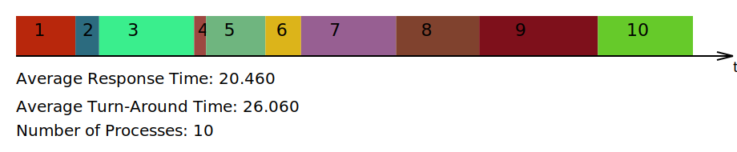
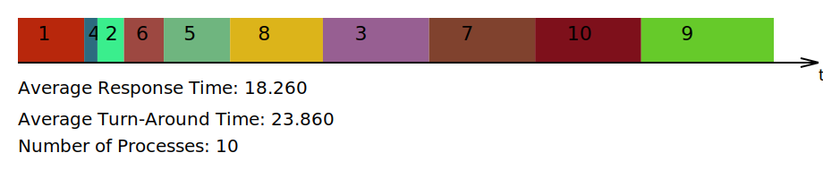
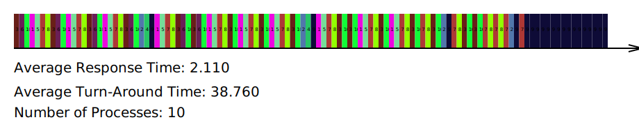

## Overview

This was a project for CMPT 360 at MacEwan University, which I built with my classmate
[Taylor Carreiro](https://github.com/TayCarr). It's a simulator of how an operating system decides
which process gets the CPU next: it runs a batch of processes under different scheduling
algorithms, logs every step and charts how long each process waited. Alongside it, we built
`findme`, our own version of the `find` command.

## How the simulator works

Each process is a text file holding how long it needs the CPU. A script creates a batch of them
with random values. The simulator then steps through time in ticks of 0.1 time units:

- **Arrivals.** Each tick, it reads one new process file into the ready queue.
- **Scheduling.** The scheduler decides which ready process gets the CPU, and that process's CPU
  time goes up by one tick. Once a process has had all the time it needs, it's done.
- **Logging.** Every tick, it writes each process's state (ready, running or done) and CPU time to
  a CSV log.

A second program reads the log and draws a timeline of which process ran when, with two averages:
the response time, how long a process waited before it first ran, and the turnaround time, how long
it took from arriving to finishing.

I built the linked list the queues are made of, along with the simulator's main loop and logging.
Taylor built the charts.

## The algorithms

The simulator can choose the next process three ways:

- **First in, first out (FIFO)** runs processes in the order they arrived, each until it's done.
- **Shortest job first (SJF)** runs whichever waiting process needs the least time, again until
  it's done. Process 1 always runs first, because it's the only one that has arrived when the CPU
  first comes free. I wrote the search for the shortest job, and changed the list so a process can
  be taken from anywhere in it, not just the end.
- **Round robin** gives each process a time slice of 0.5 time units, then sends it to the back of
  the queue if it isn't done. I implemented it.

## Example run

Here, the simulator runs one batch of 10 processes from its generator, needing between 1 and 10
time units each and 57 in total, under each algorithm. They all arrive within the first time unit,
so the CPU is never idle, and every algorithm finishes the batch at the same time.

- **Round robin responds fastest.** Every process gets its first time slice within 4.2 time units
  of arriving, for an average response time of 2.1, against 18.3 for SJF and 20.5 for FIFO.
- **SJF finishes processes fastest.** Its average turnaround time is 23.9, against 26.1 for FIFO,
  because running the short jobs first means fewer processes wait behind long ones.
- **Round robin finishes them slowest.** Its average turnaround time is 38.8. Sharing the CPU in
  slices leaves almost every process unfinished until near the end: all but the longest finish
  later than under SJF.
- **The pattern holds.** Across 20 more random batches, the order is the same every time.

These are the simulator's charts for the three runs. Each process has its own colour.

### First in, first out

### Shortest job first

### Round robin

## findme

`findme` is our own version of the `find` command: give it a starting folder, and it lists every
file under it, filtered by name, type (file, folder, link or device), owner or depth. Names can use
wildcards, like `"*.c"`.
