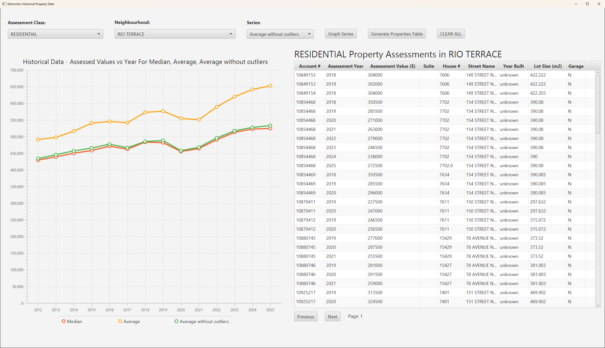
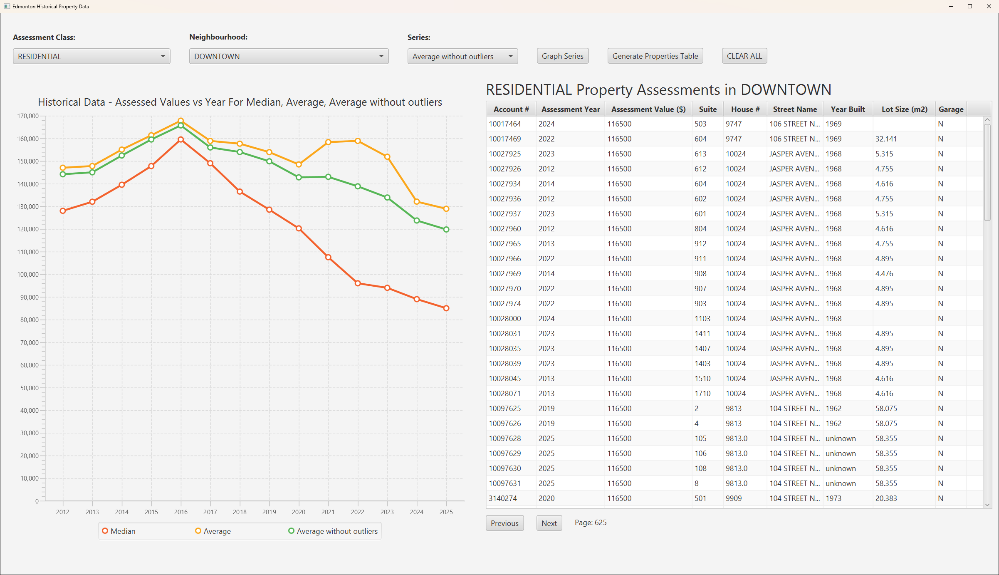

## Overview

This was our final project for CMPT 305 at MacEwan University, which I built with my classmates
[Andrew Dool](https://github.com/andrewdool92) and [Darion Kwasnitza](https://github.com/dkwas4236).
It's a desktop app for exploring how property assessments in Edmonton have changed over time: pick
an assessment class and a neighbourhood, then graph assessed values by year or browse the
properties behind them.

## The data

The app reads the City of Edmonton's
[Property Assessment Data (Historical)](https://data.edmonton.ca/d/qi6a-xuwt) straight from its
open data API. The dataset holds over 5 million assessments going back to 2012, so instead of
downloading all of it, the app asks for only the data it needs, using SoQL, the API's SQL-like query
language. It counts only properties assessed entirely in one class, and skips assessments of $0.

## What the app does

- **Filter** by assessment class, such as residential or commercial, and by neighbourhood.
- **Graph** assessed values for each year as a sum, average, average without outliers or median, and
  layer several series on one chart to compare them.
- **Browse** the matching properties 100 at a time, with each one's assessed value, address, year
  built, lot size and garage.

The first screenshot shows Rio Terrace, where the median residential assessment rose from about
$430,000 in 2012 to about $525,000 in 2025. Downtown went the other way: its median peaked at about
$160,000 in 2016 and fell to about $85,000 by 2025. In the second screenshot, its table is on page
625, the middle of its assessments.

## How it works

- **Querying the API.** We built a data access object that writes each SoQL query and parses the
  CSV the API sends back. The city's current-year and historical datasets name the neighbourhood
  column differently, so it reads the dataset's header first and adjusts its queries to match.
- **Calculating the series.** The API can sum and average values itself, so the app asks it for
  those directly. The median and the average without outliers need every assessed value, so the app
  pages through them a year at a time and calculates them itself. Outliers are values more than 1.5
  times the interquartile range below the first quartile or above the third.
- **The chart.** I built the line graph, which plots each series by year on the same chart, with a
  legend and a title that lists every series shown. It skips a series that's already on the chart.
- **The layout and filters.** I designed the window's layout, with the filters and buttons along the
  top and the chart and table side by side, resizing with the window. I filled the class and
  neighbourhood dropdowns from the API, and used a searchable dropdown from ControlsFX for the more
  than 400 neighbourhoods.
- **The table.** The table fetches only the page being viewed, using the API's limit and offset, so
  it stays fast in large neighbourhoods.
- **Testing.** We tested the data access object with JUnit against the live API.
